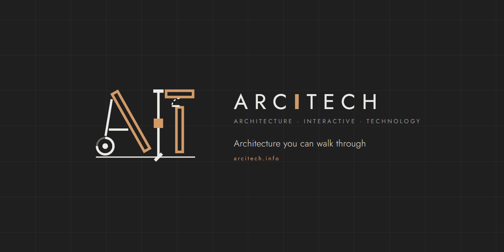

# Atelier by ARCITECH

<p align="center"></p>

**A design assistant for architects, interior designers and students, on your own computer.**
*Atelier by ARCITECH — powered by DSH (DeepSeek Harness).*

[](https://github.com/arcitech-psp/atelier/releases/latest/download/Atelier-Preview-0.1.0-Setup.exe)
[](https://github.com/arcitech-psp/atelier/releases/latest/download/atelier-preview-0.1.0-linux-x64.tar.gz)
[](https://github.com/arcitech-psp/atelier/releases)

You describe the project; Atelier works through it with you, one visible step at a time. You can stop it, change the plan or take over at any time.

> **Status: public preview (0.1.0-preview).** Expect rough edges, and please tell us what breaks.

## Install in two minutes

- **Windows 10/11:** download the installer above, open it, click through. It installs for your user only (no administrator rights), adds a Start menu entry (ARCITECH > Atelier Preview) and a desktop icon, and brings everything it needs. Not code-signed yet: if SmartScreen warns, choose **More info > Run anyway**.
- **Linux and WSL2 (Ubuntu 22.04/24.04):** download the archive, then `tar -xzf atelier-preview-0.1.0-linux-x64.tar.gz && cd atelier-preview-0.1.0-linux-x64 && ./install.sh`.
- Then **connect your model** on the Model roles page that opens the first time: Ollama, LM Studio, llama.cpp, vLLM, any OpenAI-compatible URL with a key, free cloud tiers through OmniRoute, or your ChatGPT plan.

Step by step with pictures: [Installing Atelier](docs/INSTALL.md) · [Add your endpoint](docs/add-your-endpoint.md) · [FAQ](docs/FAQ.md) · [Troubleshooting](docs/troubleshooting.md). Updates are in Settings > Updates: you check when you like (automatic updates are off unless you turn them on), and every update can be rolled back.

## Name and credits

- **Atelier** is the product. **ARCITECH** is the studio that makes it; "AIT" (Architecture · Interactive · Technology) is ARCITECH's mark, not a product name.
- Atelier is built on **[DSH (DeepSeek Harness)](https://github.com/deepseek-ai/deepseek-harness)** by DeepSeek-AI, MIT licence: the agent engine, tools, sessions and web app. The About box says which DSH release is inside (now 0.1.2-alpha.1), and Atelier follows new DSH releases ([how](docs/UPSTREAM_SYNC.md)). Package names keep their upstream `@deepseek-ai/dsh-*` names so that following DSH stays easy.
- **[IngeTrazo](https://github.com/ingelibre/ingetrazo)** by Marco Sumari Tellez and contributors (GPL-3.0-or-later) is the optional modelling program Atelier can drive. It is installed separately, never bundled.
- Contact: parthpatel266@gmail.com, or GitHub Issues.
Atelier is a fork of [DeepSeek Harness](https://github.com/deepseek-ai/deepseek-harness) by DeepSeek-AI (MIT licence). We added **Vitruvius**, a design-assistant profile built on the classic triad *Venustas* (beauty), *Firmitas* (soundness) and *Utilitas* (usefulness), a design canvas with material and colour moodboards, and an optional bridge to [IngeTrazo](https://github.com/ingelibre/ingetrazo) for live modelling.

## What is in this preview

- **Vitruvius**: general design help, editable concept plans on a canvas, and material/colour moodboards.
- **Vitruvius Zero**: the same assistant with the lightest start (about half the startup text), for small local models and modest computers. Chosen automatically for small models.
- The four stock DeepSeek Harness agent presets (Standard, PTC, Minimal and Creator modes) and its launcher profiles (web, headless, acp, sdk, sdk-minimal).
- Works with **any OpenAI-compatible model endpoint**, on your computer or elsewhere.
- Optional: generated moodboard images through your own image endpoint (for example ComfyUI).
- Optional: live modelling in IngeTrazo, which you install separately.

New and optional: dictation, "Read aloud" and meaning-based search over your project folder, each switched on when you connect the model for it (see below). Not in this preview: wind studies, the tablet app and the full brief-to-board workflow. They follow as each piece is proven.

## Bring your own models

Atelier does not include or require any particular model. It uses a few models, each for one job, and you choose every one of them under **Settings > Model roles**:

| Role | What it does | Needed? |
|---|---|---|
| Brain | Talks with you, plans and uses the tools. Vision-capable is best. | Yes |
| Vision | Looks at images, only if your brain cannot. | Optional |
| Speech to text / Text to speech | Dictation and "Read aloud". | Optional |
| Embeddings | Finds the right notes and documents in your project by meaning. | Optional |
| Image generation | Concept images for moodboards (for example through ComfyUI). | Optional |
| Small helper | A fast small model for quick side jobs. | Optional |

Each role takes any OpenAI-compatible address (Ollama, LM Studio, llama.cpp, vLLM, OmniRoute for cloud models, whisper.cpp, Kokoro and others), shows whether it is connected, and has a **Test** button. Keys stay on your computer. A role you leave empty just switches its feature off.

No model server yet? **Set me up** downloads a small working set (official llama.cpp servers, a Qwen3-VL brain sized for your graphics card and EmbeddingGemma 2, from 1.9 GB) into a folder you choose, after showing the sizes and checking your disk space, verifies every file and connects the roles. It is opt-in and nothing downloads until you press the button. Atelier is tuned for 27B-class vision models such as Qwen3.8-27B (Apache-2.0), but every model works through the same path. Each model keeps its own licence; check it fits how you work. Full guide: [docs/ROLES_SETUP.md](docs/ROLES_SETUP.md).

## Run from the source code

For developers. You need [Node.js 24](https://nodejs.org/) (the tested version is in `.node-version`); `corepack enable` provides the pinned pnpm 10.34.6.

```sh
pnpm install --frozen-lockfile
# Point Atelier at your model (first run only; local servers need no API key):
ATELIER_BASE_URL=http://localhost:8000/v1 ATELIER_MODEL=your-model-id pnpm start
```

On Windows PowerShell, set the variables first: `$env:ATELIER_BASE_URL="http://localhost:8000/v1"; $env:ATELIER_MODEL="your-model-id"; pnpm start`.

Atelier checks that your endpoint answers, then prints a local address. Open it in your browser (add `-- --open` to `pnpm start` to open it for you), choose a workspace folder, and ask Vitruvius a design question. Full details, settings and the optional extras are in [QUICKSTART.md](QUICKSTART.md), and the step-by-step guides (models, IngeTrazo, saving your work, exporting to Unreal Engine, skills, troubleshooting) are in [docs/](docs/README.md).

## In the terminal

Prefer the keyboard? `atelier` opens a terminal UI on the same engine as the web app, so your chats, profiles and model roles are shared with the browser. The terminal UI has a chats sidebar, streaming answers, collapsible tool steps and a `/` command palette. Other commands:

- `atelier chat "..."` answers one prompt; add `--json` for scripts.
- `atelier sessions list|open|export` lists, opens and saves your chats.
- `atelier roles list|set|test` shows, changes and checks your model roles.
- `atelier profile use vitruvius|vitruvius-zero|cloud` chooses the profile new chats start in.
- `atelier update check|apply|rollback` updates Atelier or goes back a version.
- `atelier doctor` checks your setup and tells you how to fix problems.

The installer puts `atelier` on your PATH (Windows, Linux and WSL). From a checkout, run `pnpm exec atelier`. See [docs/CLI.md](docs/CLI.md) for the keys, the commands and scripting examples. Atelier is made by ARCITECH.

## Bottega: team mode

**Bottega** (the Renaissance workshop where a master works with assistants) lets other people on your office network use one Atelier from their own browser, tablet or phone. One computer hosts it (the model, the tools and the project files); everyone else pairs once with a six-digit code. It is **off by default**; switch **Share on my network** on in the Bottega card on the new-session page, or start with `atelier web --bottega`. Only private network addresses are served, nothing is reachable before pairing, you see and revoke every paired device, and Atelier itself keeps listening on localhost only. Windows asks once whether to allow Atelier on **Private** networks. Anyone you pair can use Atelier as you do, so pair people you trust. Tailscale support (reaching it from outside your network) is planned and coming soon. See [docs/BOTTEGA.md](docs/BOTTEGA.md).

## What runs where

| Part | Where it runs | Needed? | Notes |
|---|---|---|---|
| Atelier | Your computer | Yes | Binds to localhost only. [Bottega](docs/BOTTEGA.md), when you switch it on, adds a pairing-protected door on your private network. |
| Language model | Your computer, or any OpenAI-compatible endpoint | Yes, your choice | Not included. If you use a remote endpoint, what you send goes there. |
| Image endpoint (e.g. ComfyUI) | Your choice | Optional | Concept images only; not included. |
| IngeTrazo + its official MCP bridge | Your computer | Optional | Separate install, GPL-3.0-or-later. Never bundled. |

## Privacy

Atelier sends no telemetry. The upstream DeepSeek Harness telemetry and session-title plugins are switched off in the shipped defaults, and the launcher sets `DSH_TELEMETRY_DISABLED=1`. Atelier talks only to the model and image endpoints you configure, to IngeTrazo on your own computer, and to web pages the agent fetches when you ask it to. The stock web-search tool calls DeepSeek's search API only if you set your own `DEEPSEEK_API_KEY`. Atelier contacts GitHub only when you press **Check for updates** in Settings > Updates, or if you turn automatic updates on (off by default).

## Honest limits

- Concept plans and moodboards are schematic design aids. Check dimensions and clearances as you would a junior's drawing.
- Generated images are concept images and a work in progress.
- Wind studies are not in this preview. When they arrive they are early design guidance only, not engineering.
- Vitruvius never certifies code compliance. Get qualified local review for structure, life safety, accessibility and permits.
- The model can be wrong, and how well Vitruvius works depends on the model you connect.

## Licences and credits

Atelier's own additions are licensed under the [PolyForm Shield License 1.0.0](LICENSE) (source-available: free to use, change and share, but not to build a competing product). DeepSeek Harness under `harness/` stays MIT, and `ingetrazo-plugin/` stays GPL-3.0-or-later. Third-party notices are in [NOTICE.md](NOTICE.md) and `licenses/`.

| Project | By | Licence | How Atelier uses it |
|---|---|---|---|
| [DeepSeek Harness](https://github.com/deepseek-ai/deepseek-harness) | DeepSeek-AI | MIT | Atelier is a fork of it |
| [IngeTrazo](https://github.com/ingelibre/ingetrazo) | Marco Sumari Tellez and contributors | GPL-3.0-or-later | Installed separately; Atelier starts its official MCP server only if you have installed it. Never bundled. |
| npm dependencies | Their authors | See `licenses/` | Installed by pnpm |

The optional IngeTrazo panel in `ingetrazo-plugin/atelier_panel` is a separate GPL-3.0-or-later download with its own README and LICENSE.

## Community

Issues and ideas: GitHub Issues. Email: parthpatel266@gmail.com.
