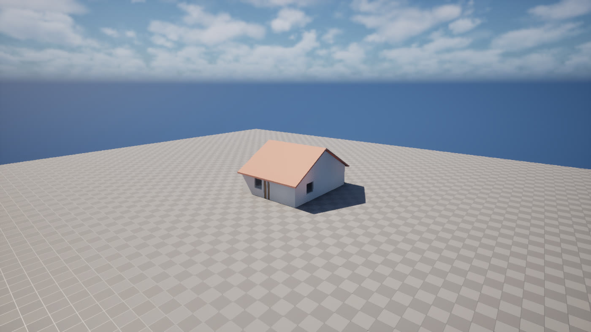

# Exporting to Unreal Engine

You can take what you model in IngeTrazo into Unreal Engine as a ready-to-place asset, at real scale, through one GLB file. In this preview Atelier does not drive Unreal; the hand-off uses IngeTrazo's own export and Unreal's own importer.

## What carries over

| | What happens |
|---|---|
| Scale | IngeTrazo works in metres, Unreal in centimetres. The GLB is in metres and Unreal converts it: a 2 m wall arrives as 200 cm. Checked on Unreal Engine 5.8 with several IngeTrazo models. |
| Up axis | IngeTrazo is Z-up and GLB is Y-up. IngeTrazo converts on export and Unreal converts back, so the model stands upright. |
| Materials | Each IngeTrazo material becomes one material instance in Unreal with its colour. Textures travel inside the GLB. Glass is exported with transparency (and, for IngeTrazo glass finishes, transmission); expect to tune glass in Unreal. |
| Pivot | The whole drawing exports as one mesh whose pivot is the **drawing origin** (0, 0, 0), not the middle of the object. |
| What is exported | Everything **visible** in the drawing. Hidden groups and layers stay out. |
| Collision | Not part of the GLB. Unreal's import settings decide it; for anything people walk on or through, set it as in step 5. |

## Step by step

**1. Model one asset per drawing, at the origin.** For a reusable asset, start a new drawing, model it with its corner or base centre at 0, 0, 0, and save it (see [Saving and reopening work](saving-and-reopening.md)). If it was built somewhere else, ask:

> Move the pergola so its south-west corner sits at 0, 0, 0.

**2. Hide what should not go.** Hide figures, reference geometry and other objects you do not want in this asset.

**3. Export.** In IngeTrazo choose **File > Export > glTF / GLB (3D, single file)...** and save, for example, `Pergola_4x3.glb`. Name it the way you want the asset to be called in Unreal.

**4. Import into Unreal.** Open your project and drag the `.glb` file into a folder in the **Content Browser** (for example `/Game/Architecture/Pergola`). Unreal's Interchange importer opens its import dialog; the defaults are fine. You get a static mesh and one material instance per material.

**5. Place it and set collision.** Drag the mesh into the level. For a stair, a floor, a pavilion or anything people walk through, open the static mesh and set **Collision Complexity** to **Use Complex Collision As Simple**, so the collision follows the real geometry. Small props can keep the default.

**6. Check the size.** Select the actor and look at its bounds, or place a default mannequin beside it. A 4 by 3 m pergola should read 400 by 300 cm.

**7. Change it later.** Edit the drawing in IngeTrazo, export again to the same file name, then right-click the asset in Unreal and choose **Reimport**.

## Things to know

- **Glass.** Unreal imports meshes from GLB with Nanite on. If glass looks opaque or wrong, open the static mesh, turn **Nanite** off for that mesh, and adjust the glass material instance.
- **One mesh.** The export is one static mesh for the whole visible drawing. For parts that must move or be swapped (a door leaf, a gate), put them in their own drawing and export them separately.
- **Export error "too many values to unpack (expected 3)".** Some scripted geometry stores colours with an alpha value, which IngeTrazo's GLB export does not accept yet. See [Troubleshooting](troubleshooting.md#glb-export-fails-with-too-many-values-to-unpack-expected-3).

Tested so far: GLB files from IngeTrazo imported into Unreal Engine 5.8 at the right size, with materials, saved and reopened. Not yet tested by us: dragging into the Content Browser on every engine version, textured models, and how glass looks under every lighting setup. Please tell us what you find.
