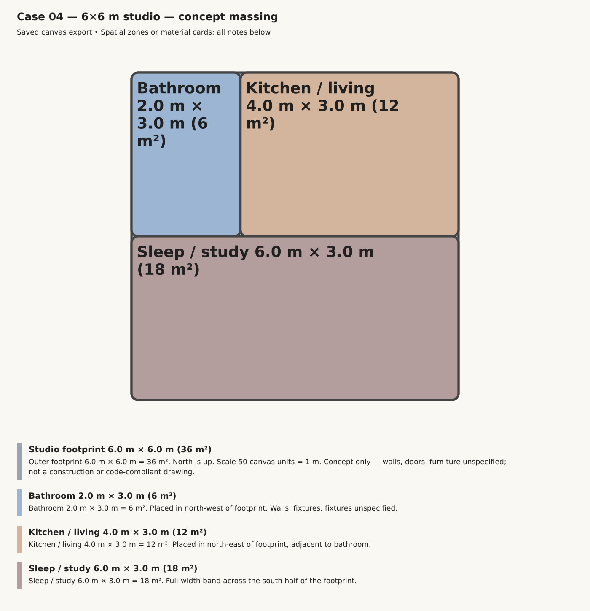
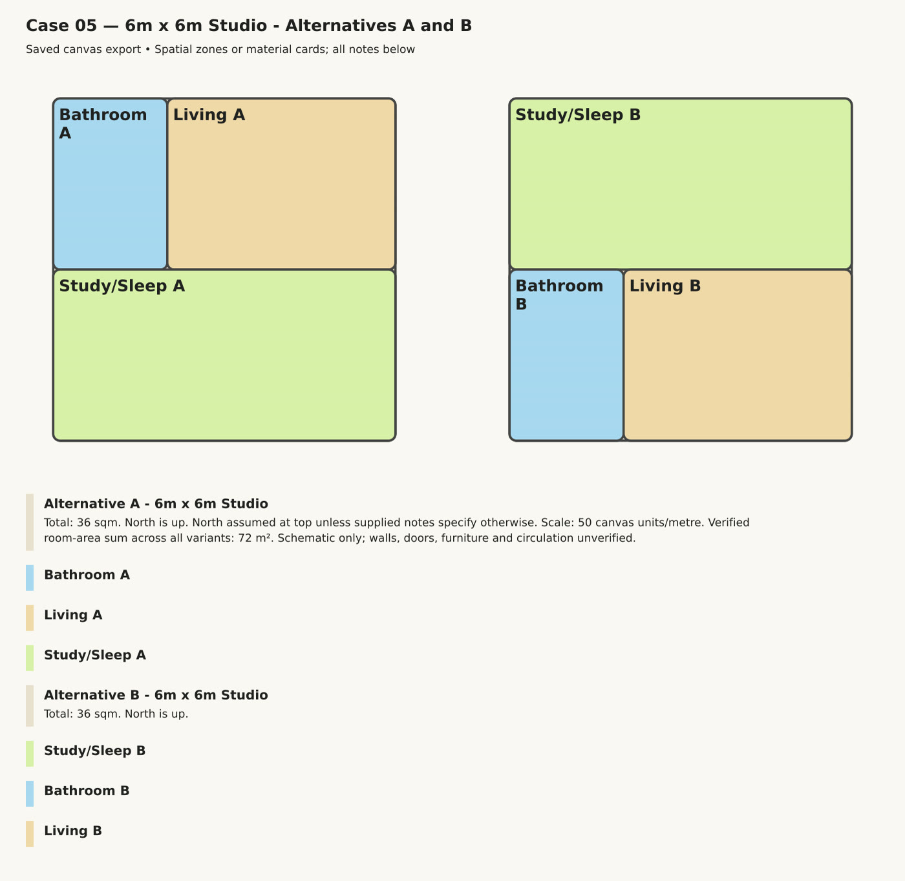
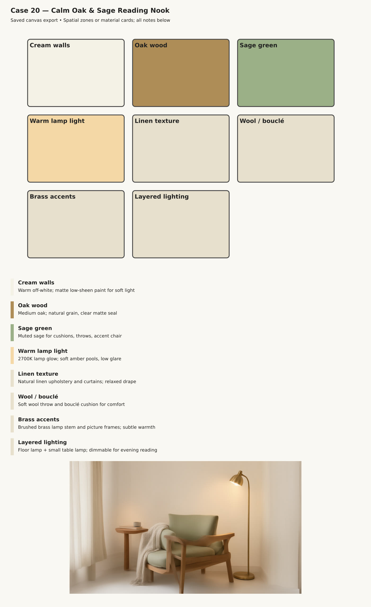

# Your first chat

## 1. Choose a workspace folder

When the app opens it asks for a **workspace**: the project folder Atelier may read and write. It works only inside that folder and asks before it runs any command. Use one folder per project, for example `Documents\Projects\Garden Studio`.

## 2. Pick Vitruvius

Choose **Vitruvius** in the profile picker. Vitruvius is the design assistant of this preview, named after the author of *De architectura* and built on his triad:

- **Venustas**: delight, proportion, light, material;
- **Firmitas**: soundness, structure, durability;
- **Utilitas**: use, circulation, clearances, the brief.

**Vitruvius Zero** sits next to it: the same assistant with the lightest start, for small models and modest computers. Atelier picks it for you when your model is small; see [Choosing a model](choosing-a-model.md#small-model-or-modest-computer-use-vitruvius-zero).

The four stock DeepSeek Harness modes (Standard, PTC, Minimal and Creator) are there too, for general work.

## 3. Ask a design question

Write as you would brief a colleague: the size, the use, the orientation, what matters. For example:

> Sketch a plan for a 6 by 6 m studio with a bathroom, a kitchen and living area, and a sleeping corner. North is up.

Vitruvius shows its plan as a short to-do list, works through it step by step, and puts the result on the **canvas**: an editable, scaled concept plan with the areas written out.

Ask for options and it draws them side by side:

> Show me two alternatives for the same studio and tell me which one gets better morning light.

## 4. Moodboards

> Make a moodboard for a calm reading nook: oak, sage and warm lamp light.

You get colour and material cards with short notes. If you connected an image service ([Choosing a model](choosing-a-model.md#optional-images-for-moodboards)), it adds a concept image, clearly labelled as a concept, not a render of your design.

## 5. Ask for a review

> Review this layout. Is the bathroom door clear of the kitchen counter?

Vitruvius answers under the three headings and says which clearances it measured and which it could not check.

## Good habits

- **Give dimensions.** Vitruvius states any number it had to assume, so you can correct it.
- **Stop it any time.** The Stop button ends the current step; you can change the plan and continue.
- **Check like you would check a junior's drawing.** Canvas plans and moodboards are schematic design aids. Vitruvius never certifies code compliance; structure, life safety, accessibility and permits need qualified local review.
- **Keep confidential work local.** If you use a cloud route, what you type goes to that provider.

Next: [Connecting IngeTrazo](ingetrazo.md) to model in real 3D.
