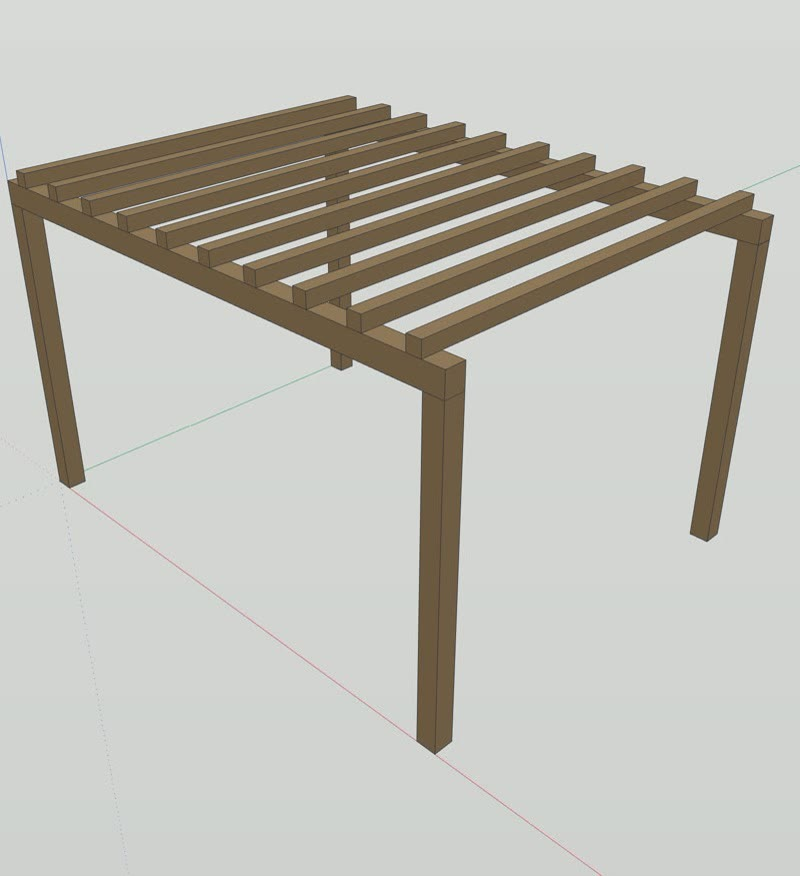

# Connecting IngeTrazo

[IngeTrazo](https://github.com/ingelibre/ingetrazo) is a free 3D modelling program for architecture, by Marco Sumari Tellez and contributors (GPL-3.0-or-later). It has an official local **AI bridge**. When it is on, Vitruvius can build, measure and look at geometry in the drawing you have open.

> **Experimental in this preview.** The connection itself works. How good the geometry is depends on the model you connect; a strong model gets simple rooms, furniture and small buildings right, a small one often does not. Always check the result in IngeTrazo before you rely on it.

## Set it up

1. **Install IngeTrazo** from its [official page](https://github.com/ingelibre/ingetrazo). Atelier never bundles it.
2. **Turn on the bridge** in IngeTrazo: the **AI** tab in the sidebar, section **AI Bridge (MCP)**, then **Start bridge** (also under **Extensions > AI Bridge (MCP)**). It listens on your own computer only, on port 4763.
3. **Open a new Vitruvius chat.** When a chat opens, Atelier checks for the bridge. If it answers, IngeTrazo's official tools appear in that chat. If not, Vitruvius tells you how to turn it on and carries on with canvas work.

On Windows, Atelier finds `ingetrazo-mcp.exe` in Program Files or your per-user Programs folder by itself. For an unusual install, set:

| Variable | Use |
|---|---|
| `ATELIER_INGETRAZO_COMMAND` | Full path of the IngeTrazo MCP program |
| `ATELIER_INGETRAZO_ARGS` | Its arguments, as a JSON array, for example `["--mcp"]` |
| `ATELIER_INGETRAZO_PORT` | Another bridge port, if you changed it in IngeTrazo |

## What Vitruvius can do there

IngeTrazo's official bridge gives the assistant five tools: run a modelling script in the open drawing, query the model (names, materials, sizes), take a screenshot of the viewport, undo and redo. Every action is one undo step, and a failed script rolls back completely, so you can always step back.

Try:

> Make a 4 by 5 m studio room with a desk and a bookshelf, then show me the plan.

Vitruvius plans the parts in metres, builds them as named groups, reads back the real sizes from the drawing, and shows a top view. It reports sizes as measured, never from the picture alone.

## Good habits

- **One drawing for one job.** Start a new drawing for experiments; Vitruvius works in the drawing you have open and leaves other tabs alone.
- **Answer IngeTrazo's dialogs first.** While IngeTrazo shows a dialog (an unsaved-changes or recovery prompt, for example), the bridge cannot answer and the chat waits.
- **Save the drawing yourself** when you like the result. See [Saving and reopening work](saving-and-reopening.md).

## The optional Atelier panel

`ingetrazo-plugin/atelier_panel` is a small panel that puts a Vitruvius chat inside IngeTrazo. It is a separate download under GPL-3.0-or-later with its own README. Copy `atelier_panel.py` into your IngeTrazo user plugins folder, restart IngeTrazo, and set the host, port (3081 by default) and Atelier home folder in its Settings.

Next: [Saving and reopening work](saving-and-reopening.md).
